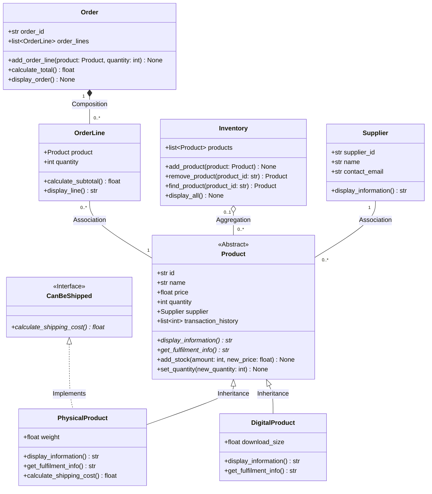

# INF1103 Lab 8: Object-Oriented Relationships Part 2
## Complete Step-by-Step Implementation & Submission Guide

This guide breaks down every task required to complete **Lab 8** (*Association, Aggregation, Composition, Type Hints, and Liskov Substitution Principle*), tailored to your current project structure with the `models/` folder.

---

## 1. Core Concepts Cheat Sheet

| Relationship | Type of Link | Ownership / Lifecycle | Guiding Question & Answer | Example in Lab |
| :--- | :--- | :--- | :--- | :--- |
| **Association** | "Knows-about" / Collaborates | **No ownership**. Independent lifecycles. | *Does one own the other?* **No.** Both can exist without each other. | `Supplier` $\leftrightarrow$ `Product` |
| **Aggregation** | "Has-a" / Whole-part (Weak) | **Weak ownership**. Whole references parts, but parts exist independently. | *If the whole goes away, does the part survive?* **Yes.** | `Inventory` $\diamondsuit\rightarrow$ `Product` |
| **Composition** | "Owns-a" / Whole-part (Strong) | **Strong / Terminal ownership**. Lifecycle of part is bound to the whole. | *If the whole goes away, does the part survive?* **No.** | `Order` $\blacklozenge\rightarrow$ `OrderLine` |

---

## 2. Project File Structure Overview

With your refactored project, the files should be arranged as follows:

```text
INF1103_Wk2/
│
├── models/
│   ├── __init__.py           # (Recommended) Package initialization
│   ├── supplier.py           # [NEW] Supplier class (Association with Product)
│   ├── order_line.py         # [NEW] OrderLine class (Part of Order, refers to Product)
│   ├── order.py              # [NEW] Order class (Composition of OrderLine)
│   ├── product.py            # Base abstract Product class (Updated with Supplier & Type Hints)
│   ├── physical_product.py   # PhysicalProduct subclass
│   ├── digital_product.py    # DigitalProduct subclass
│   ├── can_be_shipped.py     # CanBeShipped interface / abstract class
│   └── inventory.py          # Inventory class (Updated with Aggregation methods & LSP)
│
├── inventory.json            # Product storage
├── Dockerfile                # Docker setup
├── .dockerignore
├── main.py                   # CLI program
├── test.py                   # Test suite for Lab 8 verification
├── LAB8_GUIDE.md             # This guide
└── Lab8_Predict_First.docx   # Your submission document for questions
```

---

## 3. Step-by-Step Implementation Tasks

### Step 1: Association — `Supplier` & `Product`

#### 1.1 Create `models/supplier.py`
Create a `Supplier` class with type hints:
```python
class Supplier:
    def __init__(self, supplier_id: str, name: str, contact_email: str) -> None:
        self.supplier_id: str = supplier_id
        self.name: str = name
        self.contact_email: str = contact_email

    def display_information(self) -> str:
        return f"Supplier ID: {self.supplier_id} | Name: {self.name} | Contact: {self.contact_email}"
```

#### 1.2 Update `models/product.py`
Update `Product.__init__` so that it accepts a `Supplier` object:
```python
from models.supplier import Supplier

class Product(ABC):
    def __init__(
        self,
        product_id: int | str,
        name: str,
        price: float,
        quantity: int,
        supplier: Supplier,
        transaction_history: list[int] | None = None
    ) -> None:
        self.id = product_id
        self.name = name
        self.price = price
        self.quantity = quantity
        self.supplier: Supplier = supplier
        self.transaction_history = (
            transaction_history if transaction_history is not None else [quantity]
        )
```
Update `display_information()` in `Product` to include supplier details:
```python
    @abstractmethod
    def display_information(self) -> str:
        return (
            f"ID: {self.id} | Name: {self.name} | Price: ${self.price:.2f} | "
            f"Stock: {self.quantity} | Supplier: {self.supplier.name}"
        )
```

#### 1.3 Update Subclasses (`physical_product.py` and `digital_product.py`)
Ensure both constructors accept `supplier: Supplier` and pass it to `super().__init__(..., supplier=supplier)`:
```python
class PhysicalProduct(Product, CanBeShipped):
    def __init__(
        self,
        product_id: int | str,
        name: str,
        price: float,
        quantity: int,
        weight: float,
        supplier: Supplier,
        transaction_history: list[int] | None = None
    ) -> None:
        super().__init__(product_id, name, price, quantity, supplier, transaction_history)
        self.weight = weight
```
*(Do the same for `DigitalProduct` with `download_size`).*

---

### Step 2: Aggregation — `Inventory` & `Product`

In `models/inventory.py`:
1. Use type hints for the collection:
   ```python
   self.products: list[Product] = products if products is not None else []
   ```
2. Implement / verify the three required operations:
   * **`add_product(self, product: Product) -> None`**:
     ```python
     def add_product(self, product: Product) -> None:
         self.products.append(product)
     ```
   * **`remove_product(self, product_id: str | int) -> Product | None`**:
     ```python
     def remove_product(self, product_id: str | int) -> Product | None:
         for idx, p in enumerate(self.products):
             if str(p.id) == str(product_id):
                 return self.products.pop(idx)
         return None
     ```
   * **`find_product(self, product_id: str | int) -> Product | None`**:
     ```python
     def find_product(self, product_id: str | int) -> Product | None:
         for p in self.products:
             if str(p.id) == str(product_id):
                 return p
         return None
     ```
3. **Core concept check**: Notice that `remove_product()` returns the product instance and does **not** destroy it. The product can subsequently be inserted into another `Inventory` instance.

---

### Step 3: Composition — `Order` & `OrderLine`

#### 3.1 Create `models/order_line.py`
An `OrderLine` represents an item and quantity within an order. It references a `Product` (association) but belongs to an `Order`.
```python
from models.product import Product

class OrderLine:
    def __init__(self, product: Product, quantity: int) -> None:
        self.product: Product = product
        self.quantity: int = quantity

    def calculate_subtotal(self) -> float:
        return self.product.price * self.quantity

    def display_line(self) -> str:
        return (
            f"Product: {self.product.name} | Qty: {self.quantity} | "
            f"Subtotal: ${self.calculate_subtotal():.2f}"
        )
```

#### 3.2 Create `models/order.py`
The `Order` class encapsulates the creation of its `OrderLine`s (**Composition**):
```python
from models.product import Product
from models.order_line import OrderLine

class Order:
    def __init__(self, order_id: str) -> None:
        self.order_id: str = order_id
        self.order_lines: list[OrderLine] = []

    def add_order_line(self, product: Product, quantity: int) -> None:
        # Composition rule: The Order creates and manages its OrderLine instances internally
        order_line = OrderLine(product, quantity)
        self.order_lines.append(order_line)

    def calculate_total(self) -> float:
        return sum(line.calculate_subtotal() for line in self.order_lines)

    def display_order(self) -> None:
        print(f"\n--- Order ID: {self.order_id} ---")
        for line in self.order_lines:
            print(f"  {line.display_line()}")
        print(f"Total: ${self.calculate_total():.2f}")
```

---

### Step 4: Liskov Substitution Principle (LSP) & Polymorphism

1. **Eliminate `isinstance()` checks in `Inventory.display_all()`**:
   * Previously, `inventory.py` had:
     ```python
     if isinstance(product, PhysicalProduct):
         product_str += f" | Shipping Cost: ${product.calculate_shipping_cost():.2f}"
     ```
   * Sections 6 & 7 specifically require that `Inventory` should treat every product uniformly through the `Product` abstraction without inspecting specific subclasses.
   * Remove that `isinstance` branch and rely on polymorphic methods like `product.display_information()` and `product.get_fulfilment_info()`.
2. **Substitutability Verification Function**:
   Create a test function accepting `Product` to prove both `PhysicalProduct` and `DigitalProduct` behave interchangeably:
   ```python
   def show_product_details(product: Product) -> None:
       print(product.display_information())
       print(product.get_fulfilment_info())
   ```

---

### Step 5: Complete Verification Suite in `test.py`

Update `test.py` so you can demonstrate all 3 relationships, LSP, and polymorphism in one execution:

```python
from models.supplier import Supplier
from models.physical_product import PhysicalProduct
from models.digital_product import DigitalProduct
from models.product import Product
from models.inventory import Inventory
from models.order import Order

def show_product_details(product: Product) -> None:
    print(product.display_information())
    print("Fulfilment:", product.get_fulfilment_info())

def main():
    print("=" * 60)
    print("1. TESTING ASSOCIATION: Supplier & Product")
    print("=" * 60)
    supplier1 = Supplier("S001", "Global Logistics Co.", "support@globallogistics.com")
    prod_phys = PhysicalProduct(1, "Ergonomic Keyboard", 120.0, 50, 1.2, supplier1)
    prod_dig = DigitalProduct(2, "Python Pro IDE License", 89.99, 100, 450, supplier1)

    print("Products successfully created with shared Supplier.")
    # Test deleting local supplier variable
    del supplier1
    print("Deleted 'supplier1' variable. Products can still access supplier:")
    print(prod_phys.display_information())
    print(prod_dig.display_information())

    print("\n" + "=" * 60)
    print("2. TESTING AGGREGATION: Inventory & Product")
    print("=" * 60)
    inv_a = Inventory()
    inv_b = Inventory()

    inv_a.add_product(prod_phys)
    print(f"Inventory A count after adding: {inv_a.count_products()}")

    removed_item = inv_a.remove_product(1)
    print(f"Removed item '{removed_item.name}' from Inventory A. Inv A count: {inv_a.count_products()}")
    print("Item still exists in memory and will now be added to Inventory B:")
    inv_b.add_product(removed_item)
    print(f"Inventory B count: {inv_b.count_products()}")

    print("\n" + "=" * 60)
    print("3. TESTING COMPOSITION: Order & OrderLine")
    print("=" * 60)
    order1 = Order("ORD-1001")
    order1.add_order_line(prod_phys, 2)
    order1.add_order_line(prod_dig, 1)
    order1.display_order()

    order2 = Order("ORD-1002")
    order2.add_order_line(prod_phys, 3)
    order2.display_order()

    print(f"\nOrder 1 Line 0 Product ID: {id(order1.order_lines[0].product)}")
    print(f"Order 2 Line 0 Product ID: {id(order2.order_lines[0].product)}")
    print(f"Same Product Object in memory? {order1.order_lines[0].product is order2.order_lines[0].product}")
    print(f"OrderLine Objects distinct? {order1.order_lines[0] is not order2.order_lines[0]}")

    print("\n" + "=" * 60)
    print("4. TESTING LSP & POLYMORPHISM")
    print("=" * 60)
    test_inventory = Inventory([prod_phys, prod_dig])
    for p in test_inventory.products:
        show_product_details(p)
        print("-" * 40)

if __name__ == "__main__":
    main()
```

---

## 4. "Predict First" & "Diagnose" Answer Key (For your Word Doc)

### Prediction 1 (Section 2.2 — Association)
* **Question**: *What happens if you delete your supplier variable (`del supplier`) after creating the products? Can each Product still display its supplier information?*
* **Prediction**: Yes.
* **Explanation / What happened**: `del supplier` only removes the local variable reference from the local namespace. The `Supplier` object itself remains alive in Python's heap memory because each `Product` retains a reference in `self.supplier`.

### Prediction 2 (Section 3.2 — Aggregation)
* **Question**: *Does the Product still work after it is removed from Inventory A, and why?*
* **Prediction**: Yes.
* **Explanation / What happened**: Aggregation represents weak ownership. `Inventory` only holds a collection of references to products. Removing a product from `Inventory A` removes the reference from the list, but does not destroy the `Product` object. It can be transferred and added to `Inventory B`.

### Prediction 3 (Section 4.3 — Composition)
* **Question**: *If you add the same Product to two different Orders, how many OrderLine objects and how many Product objects will exist?*
* **Prediction**: 2 `OrderLine` objects and 1 `Product` object.
* **Explanation / What happened**: Each `Order` instantiates its own `OrderLine` (`add_order_line()`), so two separate `OrderLine` instances are created. Both `OrderLine` instances hold a reference to the single shared `Product` object.

### Prediction 4 (Section 7.2 — Polymorphism)
* **Question**: *What will each product print for `get_fulfilment_info()`?*
* **Prediction**:
  * PhysicalProduct: `"This product requires physical shipping"`
  * DigitalProduct: `"This product is delivered digitally"`
* **Explanation / What happened**: Method overriding ensures that Python dispatches the call to the subclass's implementation at runtime without requiring an `isinstance()` check.

### Diagnose Question (Section 6.3 — LSP)
* **Question**: *DigitalProduct method proposed:*
  ```python
  class DigitalProduct(Product):
      def update_stock(self, quantity: int) -> None:
          raise NotImplementedError("Digital products have no stock")
  ```
  *Does this violate LSP? What would you change: the subclass, the parent class (Product), or the inheritance relationship?*
* **Answer**:
  * **Yes, this strictly violates LSP.** Code expecting a `Product` and calling `update_stock()` will crash when passed a `DigitalProduct`.
  * **Solution**: Either:
    1. DigitalProduct can implement `update_stock()` cleanly without raising an exception (e.g. Treat stock as infinite or a no-op).
    2. Or refactor the parent class/interfaces so that stock management is not forced onto classes that do not have physical inventory.

---

## 5. UML Class Diagram Specification

Use this Mermaid diagram as a direct reference for your UML diagram submission:



---

## 6. Git & Docker Workflow

Once code is updated and tested, run the following commands:

```bash
# 1. Check working directory status
git status

# 2. Stage updated files
git add models/ supplier.py order.py order_line.py product.py inventory.py test.py LAB8_GUIDE.md

# 3. Commit with a clear message
git commit -m "feat(lab8): implement association, aggregation, composition, type hints and LSP"

# 4. Push to remote
git push origin main

# 5. Build and run Docker container to verify execution
docker build -t inf1103-lab8 .
docker run -it --rm inf1103-lab8
```

---

## 7. Submission Checklist
- [ ] Updated Python files in `models/` (`supplier.py`, `order_line.py`, `order.py`, `product.py`, `inventory.py`, `physical_product.py`, `digital_product.py`).
- [ ] Type hints present across attributes, method parameters, and return types.
- [ ] `isinstance()` checks removed from inventory display logic (LSP compliance).
- [ ] `test.py` running successfully to verify Association, Aggregation, Composition, LSP, and Polymorphism.
- [ ] Word document containing answers to the 4 "Predict First" questions and the "Diagnose" question.
- [ ] UML class diagram exported (matching Section 5).
- [ ] Git commit and Docker execution screenshots.
